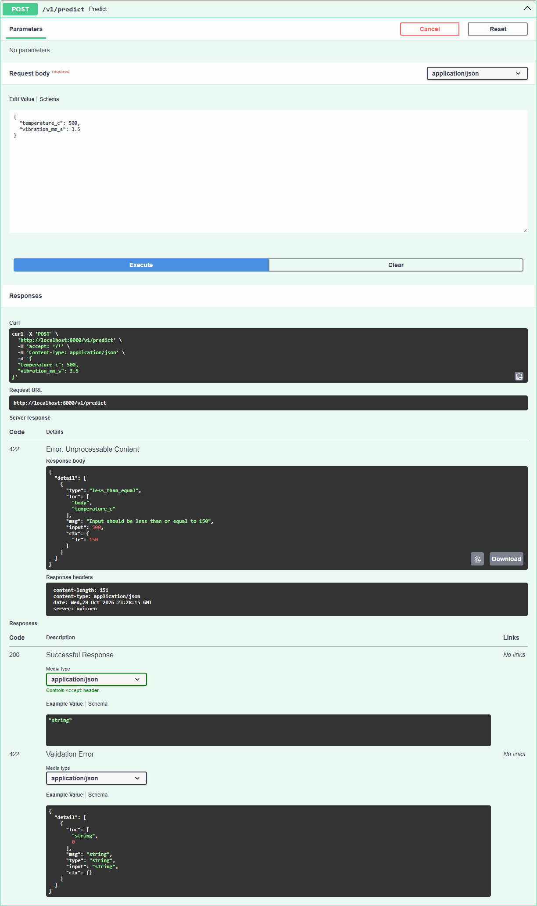

# Activité 4 : Votre première API

**Nom :** Anass Habachi · **Groupe :** G1

## Ce que fait l'API

`demo_api.py` est une petite API écrite avec FastAPI et lancée par uvicorn. Elle a deux routes :

- **`GET /health`** : sert à vérifier que l'API est en marche. Elle répond toujours `{"status": "ok"}`.
- **`POST /v1/predict`** : reçoit un relevé de capteurs en JSON (température et vibration) et renvoie `{"alert": true}` si la température dépasse 80 °C, sinon `{"alert": false}`.

`GET` sert à lire une information, `POST` sert à envoyer des données à l'API (ici, le relevé dans le corps de la requête).

## Le schéma et ses trois usages

Le schéma est la classe `Reading` : elle décrit les données attendues (le nom de chaque champ, son type et ses bornes).

```python
class Reading(BaseModel):
    temperature_c: float = Field(ge=-40, le=150, description="Température du moteur (°C)")
    vibration_mm_s: float = Field(ge=0, le=50, description="Vitesse de vibration efficace (mm/s)")
```

On l'écrit une seule fois, et FastAPI s'en sert pour trois choses :

1. **Valider** : avant d'appeler la fonction `predict()`, FastAPI vérifie chaque requête. Si une valeur est hors bornes ou si un champ manque, il répond **422** et la fonction n'est jamais appelée.
2. **Documenter** : la page `http://localhost:8000/docs` est construite automatiquement, avec chaque champ, son type, ses bornes et sa description, et un bouton « Try it out » pour tester.
3. **Donner un objet Python typé** : dans `predict()`, `reading` n'est pas un texte JSON mais un objet. `reading.temperature_c` est un `float` déjà vérifié entre -40 et 150.

## Résultats des tests

Tests faits avec `curl.exe` et la page `/docs`, sur `http://localhost:8000`.

| Requête | Code obtenu | Explication |
|---|---|---|
| `GET /health` | 200 | L'API est en marche, réponse `{"status":"ok"}`. |
| `POST /v1/predict` avec `{"temperature_c": 70}` (schéma de départ) | 200 | 70 °C est dans les bornes ; 70 n'est pas > 80, donc `{"alert":false}`. |
| `POST /v1/predict` avec `{"temperature_c": 500}` (schéma de départ) | 422 | 500 dépasse la borne `le=150` : la requête est refusée avant d'arriver à `predict()`. |
| `curl.exe` avec `releve.json` = `{"temperature_c": 70}` (schéma de départ) | 200 | Même résultat que dans `/docs` : `{"alert":false}`. |
| `curl.exe` avec `releve.json` = `{"temperature_c": 70, "vibration_mm_s": 3.5}` (après l'ajout de la vibration) | 200 | Les deux valeurs sont dans les bornes : `{"alert":false}`. |
| `POST /v1/predict` avec `{"temperature_c": 70, "vibration_mm_s": 80}` | 422 | 80 dépasse la borne `le=50` de la vibration. |
| `POST /v1/predict` avec `{"temperature_c": 70}` seul (après l'ajout de la vibration) | 422 | `vibration_mm_s` est maintenant obligatoire : `"Field required"`. |

Sorties exactes des deux commandes `curl.exe` du polycopié (schéma de départ) :

```
> curl.exe http://localhost:8000/health
{"status":"ok"}

> curl.exe -X POST http://localhost:8000/v1/predict -H "Content-Type: application/json" -d "@releve.json"
{"alert":false}
```

## La réponse 422

Corps exact de la réponse pour une température de 500 °C :

```json
{"detail":[{"type":"less_than_equal","loc":["body","temperature_c"],"msg":"Input should be less than or equal to 150","input":500,"ctx":{"le":150.0}}]}
```

- **`loc`** (location) : **où** est l'erreur. `["body", "temperature_c"]` veut dire : dans le corps de la requête, le champ `temperature_c`.
- **`msg`** (message) : **pourquoi** la valeur est refusée : elle doit être inférieure ou égale à 150.
- **`input`** : la valeur reçue qui pose problème, ici `500`.
- `type` et `ctx` précisent la règle non respectée (`less_than_equal`, avec la limite `le: 150`).

Pour une vibration de 80, la réponse a la même forme :

```json
{"detail":[{"type":"less_than_equal","loc":["body","vibration_mm_s"],"msg":"Input should be less than or equal to 50","input":80,"ctx":{"le":50.0}}]}
```

Capture de `/docs` avec le 422 à 500 °C :



## Le champ vibration_mm_s

```python
vibration_mm_s: float = Field(ge=0, le=50, description="Vitesse de vibration efficace (mm/s)")
```

- **Minimum 0** : la vibration est mesurée comme une vitesse efficace (valeur moyenne), elle ne peut pas être négative.
- **Maximum 50 mm/s** : selon la norme ISO 10816, une machine devient « dangereuse » à partir d'environ 11 mm/s (petites machines) jusqu'à environ 45 mm/s (grosses machines). Au-delà de 50 mm/s, la machine serait déjà en train de se détruire : une telle valeur vient plutôt d'un capteur défaillant.
- **Type `float`** : une vibration se mesure avec des décimales (par exemple 3,5 mm/s).

Après l'ajout, `/docs` affiche bien le nouveau champ dans le schéma `Reading`, avec son type (`number`), ses bornes (0 et 50) et sa description.

## Comment lancer l'API

Depuis le dossier `TP\Activite4`, dans PowerShell :

```powershell
python -m venv .venv
.venv\Scripts\Activate.ps1          # cmd : .venv\Scripts\activate.bat
pip install -r requirements.txt
uvicorn demo_api:app --reload
```

Puis ouvrir `http://localhost:8000/docs`. Dans une **deuxième** fenêtre :

```powershell
curl.exe http://localhost:8000/health
curl.exe -X POST http://localhost:8000/v1/predict -H "Content-Type: application/json" -d "@releve.json"
```

`Ctrl+C` arrête le serveur.

## Ce qui reste flou

- Comment l'API MaintAI remplacera la règle simple « température > 80 » par la vraie prédiction du modèle entraîné (ce sera le TP1).
- Pourquoi `--reload` ne recharge pas toujours l'API sous Windows : pendant les tests, il a fallu arrêter et relancer uvicorn pour voir le nouveau champ.
